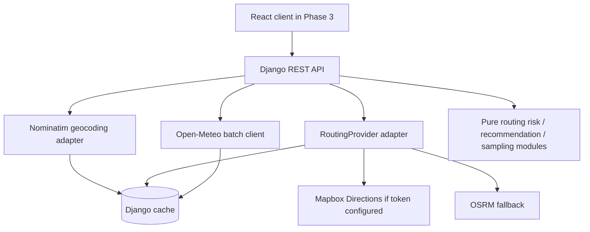

# Spotter AI — Phase 2: Providers and API

This phase adds a runnable Django REST API, provider adapters, caching, and ETA-aware checkpoint weather. It preserves the pure Python logic in `backend/routing/`.

## Requirements

- Python 3.14
- Windows 10/11 PowerShell
- Internet access for real provider requests
- Mapbox token is optional. Without one, routing uses the public OSRM demo service.

## Install and run (PowerShell)

From the repository root:

```powershell
cd backend
py -3.14 -m venv .venv
.\.venv\Scripts\Activate.ps1
python -m pip install --upgrade pip
pip install -r requirements-dev.txt
Copy-Item .env.example .env
python manage.py check
python -m pytest
python manage.py runserver
```

For cross-origin frontend development, `django-cors-headers` is configured for `http://localhost:5173` by default. Set `CORS_ALLOWED_ORIGINS` to the exact frontend origin(s) you use.

Django does not load `.env` automatically in this phase. Set variables in your terminal or configure them in your IDE before running. Before making a real Nominatim request, replace the placeholder with an app-identifying User-Agent that includes a real contact address. For example:

```powershell
$env:DJANGO_DEBUG = "true"
$env:NOMINATIM_USER_AGENT = "SpotterAI-Assessment/1.0 (your-email@example.com)"
# Optional:
$env:MAPBOX_ACCESS_TOKEN = "your-mapbox-token"
```

The API starts at `http://127.0.0.1:8000`.

## Endpoints

### `GET /api/geocode?q=Berlin`

Returns `{ "suggestions": [{ "label", "lat", "lon", "provider_id" }] }`. Uses Nominatim, caches normalized queries for 24 hours, and sends a configurable User-Agent. Keep usage modest; Nominatim is a shared public service, not a high-volume autocomplete backend.

### `POST /api/routes/analyze`

Example request:

```json
{
  "origin": "Berlin, Germany",
  "destination": "Hamburg, Germany",
  "departure_time": "2026-10-20T08:30:00+02:00",
  "load_weight_lb": 25000,
  "interval_miles": 25
}
```

You can supply coordinates instead of a text place name by using `origin_point` / `destination_point`, e.g. `{"lat": 52.52, "lon": 13.405, "label": "Berlin"}`. `interval_miles` is optional and must be 10, 25, or 50; omitted intervals use the Phase 1 adaptive rule.

The response contains available routes (up to 3), GeoJSON LineString geometry, checkpoint coordinates/mile markers/ETAs, weather, base/final risk, reasons, mileage-weighted summaries, recommendation ID and reason, and notices when fewer than 3 routes are available. Weather can be partially unavailable; affected checkpoints use `final_level: "UNKNOWN"`, `weather: null`, and `weather_status: "unavailable"`. Their owned mileage is conservatively counted as Severe for ranking and is also exposed separately as `unknown_miles`; this avoids treating missing data as safe.

Validation errors use HTTP 400. Unresolved places use HTTP 422. Provider failures use HTTP 502. Unexpected failures return a generic HTTP 500 response without leaking provider payloads or secrets.

## Provider and caching design



- Routing is behind a `RoutingProvider` protocol. Mapbox is preferred when `MAPBOX_ACCESS_TOKEN` is configured; any Mapbox error falls back to OSRM. OSRM can return fewer than three alternatives; the API reports the actual count rather than inventing routes.
- Geocoding is behind a `GeocodingProvider` protocol and currently uses Nominatim.
- Open-Meteo requests batch up to 50 unique rounded coordinates per request. Forecasts are cached by rounded latitude/longitude and unit settings. Route/geocode responses are also cached.
- Django LocMem cache is the default. Set `REDIS_URL` to use Django's Redis cache backend for shared cache across workers.
- Open-Meteo's wind speed is requested in mph. Rain is converted from mm/hour to inches/hour (`/25.4`). Snowfall is converted from cm/hour to inches/hour (`/2.54`) and represents snow depth, not liquid-water equivalent.
- Weather selection uses the forecast hour nearest to each checkpoint's ETA, not the departure time. ETAs use route step-duration profiles when available, with distance interpolation as a fallback. Values outside the returned forecast time range clamp to the nearest endpoint and set `extrapolated: true`.
- Weather API failure is isolated per batch; missing checkpoints are marked UNKNOWN and conservatively penalized in route ranking. If the route provider or required geocoding fails, analysis returns an explicit API error.

## Known limitations for this phase

- The heatmap endpoint and all 49 preloaded forecast frames are Phase 4.
- Nominatim public service usage is rate-limited by its policy; production-grade high-volume autocomplete requires a compliant provider or self-hosting. This adapter caches requests but does not implement a distributed rate limiter.
- OSRM's public demo endpoint has no SLA and may return fewer than three alternatives. Configure Mapbox for more reliable alternatives; if only one or two distinct routes exist, the response says so.
- Forecast availability varies by location and provider. This phase requests seven days; ETAs beyond the last available hour are clamped and flagged.
- Open-Meteo `wind_speed_10m` is sustained wind at 10 metres, not gust speed.
- This phase is backend-only; deployment and frontend CORS polish are Phase 5.
