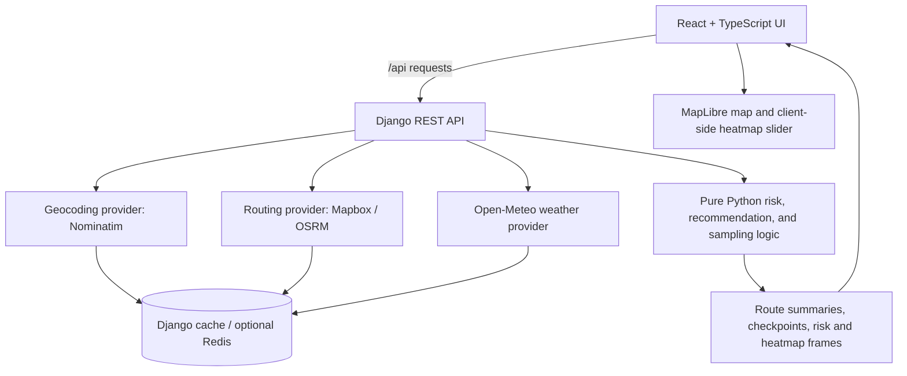

# Spotter — Weather-Aware Truck Routing

A weather-aware route comparison app for truck trips. Spotter combines drivable route alternatives, ETA-aware weather checkpoints, load-sensitive risk classification, route ranking, and a time-slider heatmap so a driver can compare forecast conditions before departure.

- **Live application:** https://spotter-ai-weather-aware-routing.vercel.app/
- **Backend health check:** https://spotter-ai-weather-aware-routing.onrender.com/api/health
- **Repository:** https://github.com/MahdiNoorzadeh/spotter-ai-weather-aware-routing

> **Decision-support notice:** Forecasts are estimates, not guarantees of road conditions or official closure information. Use official weather and road advisories when making operational decisions.

## Features

- Origin and destination autocomplete through the geocoding API.
- Timezone-aware departure date and time, load weight in pounds, and configurable checkpoint interval.
- Up to three distinct drivable route options. The UI reports when the routing provider can only return one or two alternatives rather than fabricating routes.
- Weather sampled along each route at checkpoints, using the truck's estimated arrival time at each checkpoint.
- Risk classification for wind, rain, and snow, followed by load-dependent wind rules.
- Route summaries and deterministic recommendation based on risk first and travel time as the final tie-breaker.
- MapLibre map with route lines, risk-coloured checkpoint markers, and checkpoint condition details.
- A forecast heatmap with 49 preloaded hourly frames covering offsets 0–48 hours. Scrubbing uses data already in the browser; it does not request a new frame on each slider movement.
- Loading, validation, API-error, partial-weather, and no-safe-route messaging.

## Technology

**Frontend**
- React 18, TypeScript, Vite
- MapLibre GL JS through `react-map-gl`
- TanStack Query for data fetching and Zustand for shared route/selection state
- Tailwind CSS

**Backend**
- Django 5.2 and Django REST Framework
- Python routing logic separated into provider-independent modules
- `httpx` for external API requests
- Django cache, with optional Redis configuration
- Pytest, pytest-django, Ruff, and Black for backend verification

**External services**
- **Routing:** Mapbox Directions when configured, with OSRM fallback.
- **Geocoding:** Nominatim.
- **Weather:** Open-Meteo hourly forecasts.
- **Map tiles/style:** CARTO Positron using OpenStreetMap-derived map data.

## Architecture



## API

The production backend is hosted at `https://spotter-ai-weather-aware-routing.onrender.com`.

### `GET /api/health`

Returns a small health response used to confirm the backend is reachable.

### `GET /api/geocode?q=Berlin`

Returns location suggestions for the autocomplete control. Nominatim requests are cached and use a configurable identifying User-Agent. The public Nominatim service is rate-limited; this implementation is intended for modest assessment/demo traffic, not high-volume production autocomplete.

### `POST /api/routes/analyze`

Analyzes the available route candidates for a trip. The request includes:

```json
{
  "origin": "Berlin, Germany",
  "destination": "Hamburg, Germany",
  "departure_time": "2026-10-21T09:00:00+02:00",
  "load_weight_lb": 40000,
  "interval_miles": 25
}
```

The departure timestamp must include a timezone offset. The interval is optional and accepts `10`, `25`, or `50` miles. When omitted, the backend chooses an adaptive interval:

- 10 miles for routes shorter than 150 miles
- 25 miles for routes from 150 through 500 miles, inclusive
- 50 miles for routes longer than 500 miles

The response includes available routes, route geometry, distance and duration, checkpoints with ETA/weather/risk details, mileage-weighted summaries, the recommended route, and an explanation. The API returns the distinct routes available from the provider, up to three. When weather is unavailable at a checkpoint, it is marked as unknown and conservatively penalized for ranking instead of being treated as safe.

### `GET /api/heatmap`

Returns all 49 hourly forecast frames for the trip corridor in one response. The request accepts either origin/destination place names or coordinate pairs, plus a timezone-aware departure timestamp and load weight. The frontend currently samples the corridor at 20-mile intervals.

Each frame contains GeoJSON point features with a risk level, intensity, weather measurements, and weather-availability metadata. The map slider selects one of these frames client-side, so scrubbing does not trigger another API request for every hour.

## Risk classification

Wind, rain, and snow are classified independently. The worst of the three classifications is the base risk; load rules are then applied without lowering that risk.

| Condition | Low | Moderate | High | Severe | No Travel |
|---|---:|---:|---:|---:|---:|
| Wind speed | `<25 mph` | `25 to <35 mph` | `35 to <45 mph` | `45 to <55 mph` | `>=55 mph` |
| Rain rate | `<0.10 in/hr` | `0.10 to <0.25` | `0.25 to <0.50` | `0.50 to 1.00` | `>1.00 in/hr` |
| Snow depth rate | `<0.5 in/hr` | `0.5 to <1.0` | `1.0 to <2.0` | `2.0 to 3.0` | `>3.0 in/hr` |

Boundary rules are intentional: the lower bound of each band is inclusive; the upper bound is exclusive except that rain exactly `1.00 in/hr` and snow exactly `3.00 in/hr` remain Severe. Values above those values are No Travel.

### Load-dependent wind rules

- Wind `>=55 mph` means No Travel for any load.
- Wind `>=45 mph` and `<55 mph` with load `>30,000 lb` means No Travel.
- Wind `>=35 mph` and `<45 mph` with load `>40,000 lb` raises risk to at least Severe.
- Load thresholds are strict: exactly 30,000 lb or 40,000 lb does not trigger the corresponding override.
- The final risk is never lower than the base weather risk.

Risk scores used for average-risk summaries are Low `0`, Moderate `1`, High `2`, Severe `3`, and No Travel `4`.

## Route recommendation and mileage accounting

Routes are ranked in this order:

1. A route with **zero No Travel miles** ranks above every route that contains No Travel miles.
2. If every route has No Travel miles, the route with the fewest No Travel miles ranks first; the UI warns: **“No safe route at this departure time”** and still presents the least-bad available route.
3. Among the remaining candidates, prefer fewer Severe miles.
4. Then prefer fewer High miles.
5. Then prefer the lowest mileage-weighted average risk.
6. Finally, prefer the shortest travel time.

The ranking is lexicographic, so a later criterion only breaks a tie on earlier criteria. Average risk is weighted by the miles assigned to each checkpoint. A checkpoint owns the road segment between the midpoints to its adjacent checkpoints; the first and last checkpoint segments extend to the origin and destination respectively.

## Weather, ETAs, and limitations

- Checkpoint ETA is based on cumulative route duration from the departure time, using routing duration-profile points when available and distance interpolation as a fallback.
- Weather is selected for the forecast hour nearest to each checkpoint's ETA.
- If an ETA falls outside the provider's available forecast timestamps, the nearest endpoint is used and the data is flagged as extrapolated.
- Open-Meteo wind speed is sustained wind at 10 metres, not gust speed.
- Rain is converted from millimetres/hour to inches/hour.
- Open-Meteo snowfall is converted from centimetres/hour to inches/hour and represents **snow depth**, not liquid-water equivalent.
- The heatmap is a corridor approximation: route-centreline samples plus two offset samples. It is not a high-resolution meteorological grid or a road-surface model.
- Missing weather is labelled `UNKNOWN`; the heatmap uses a conservative visual intensity rather than depicting unavailable data as safe. In route ranking, unknown-weather mileage is conservatively penalized.
- The routing provider may return fewer than three distinct routes for some origin/destination pairs.
- The free OSRM demo and public geocoding/map services have availability, usage-policy, and rate-limit constraints. They do not provide a production SLA.
- Forecasts do not guarantee real road conditions and do not represent live road closures.
- The current deployment uses the free Render service tier, which may take time to wake after inactivity.

## Run locally

Prerequisites: Git, Node.js/npm, and a Python version compatible with the backend dependencies. The deployment currently specifies Python `3.13.4`; the backend project configuration and test tooling should be used when selecting a local interpreter.

### 1. Clone the repository

```powershell
git clone https://github.com/MahdiNoorzadeh/spotter-ai-weather-aware-routing.git
cd spotter-ai-weather-aware-routing
```

### 2. Start the backend

```powershell
cd backend
py -3.13 -m venv .venv
.\.venv\Scripts\Activate.ps1
python -m pip install --upgrade pip
pip install -r requirements-dev.txt
python manage.py check
python -m pytest
python manage.py runserver 127.0.0.1:8000
```

If you use another supported Python version, substitute the corresponding `py` launcher version. The backend's `requirements-dev.txt` includes test and lint tools; `requirements.txt` is used for the deployed service.

The backend reads configuration from environment variables. Set the required values in your shell or IDE for local work; do not commit `.env` files or credentials. For Nominatim, configure `NOMINATIM_USER_AGENT` to identify the application and include a valid contact method before making real requests. `MAPBOX_ACCESS_TOKEN` is optional; without it, routing falls back to OSRM. `REDIS_URL` is optional; without it, the configured local-memory cache can be used.

### 3. Start the frontend

Open a second PowerShell terminal:

```powershell
cd path\to\spotter-ai-weather-aware-routing\frontend
npm ci
npm run typecheck
npm run build
npm run dev
```

Open `http://127.0.0.1:5173`. Vite proxies `/api` requests to `http://127.0.0.1:8000` for local development.

For a frontend that calls a separate backend origin directly, set `VITE_API_BASE_URL` before running the build. For example, create `frontend/.env.local`:

```dotenv
VITE_API_BASE_URL=http://127.0.0.1:8000
```

Vite embeds `VITE_*` variables at build time. After changing this variable, restart the dev server or rebuild/redeploy the frontend. Do not put secrets in `VITE_*` variables because they are exposed to browser code.

## Tests and quality checks

Run backend checks from `backend/`:

```powershell
python manage.py check
python -m pytest
ruff check routing api config
black --check routing api config
```

Run frontend checks from `frontend/`:

```powershell
npm run typecheck
npm run build
```

The automated backend tests cover risk thresholds and load overrides, route ranking and summary logic, checkpoint sampling/segment mileage/ETA interpolation, geometry, weather handling, and heatmap behavior. Tests should use controlled inputs or mocked providers rather than depending on live third-party APIs.

## Deployment

### Backend — Render

The repository includes `render.yaml` for the Django service. The configured service uses the `backend` directory, installs `requirements.txt`, runs `collectstatic`, starts Gunicorn, and checks `/api/health`.

Production backend:
`https://spotter-ai-weather-aware-routing.onrender.com`

Confirm these environment settings in Render before deployment:

- `DJANGO_DEBUG=false`
- `DJANGO_SECRET_KEY` generated and kept private
- `DJANGO_ALLOWED_HOSTS` includes the Render host
- `CORS_ALLOWED_ORIGINS` includes `https://spotter-ai-weather-aware-routing.vercel.app`
- `NOMINATIM_USER_AGENT` identifies the application
- Provider/cache/timeout settings match the environment

Never commit the real Django secret key or any API credentials.

### Frontend — Vercel

The Vercel project should use:

- Framework preset: **Vite**
- Root directory: `frontend`
- Build command: `npm run build`
- Output directory: `dist`
- Production environment variable:

```dotenv
VITE_API_BASE_URL=https://spotter-ai-weather-aware-routing.onrender.com
```

Vite environment variables are embedded during the build. After changing one in Vercel, redeploy so a new production bundle is generated. To verify the frontend configuration, inspect the built JavaScript bundle or the browser Network panel and confirm API calls target the Render backend, not a relative `/api/...` path on Vercel.

Production frontend:
`https://spotter-ai-weather-aware-routing.vercel.app/`
